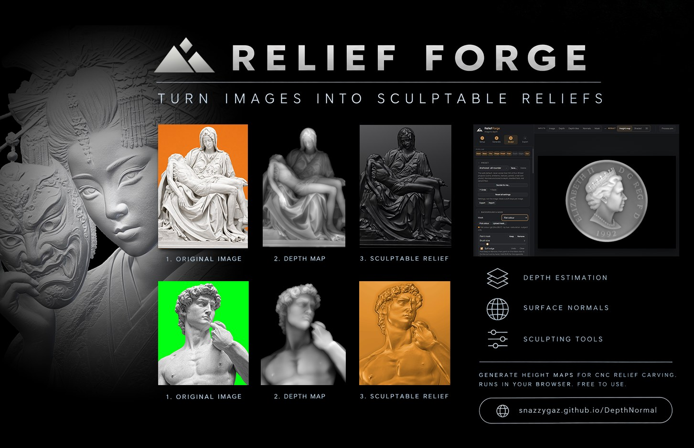
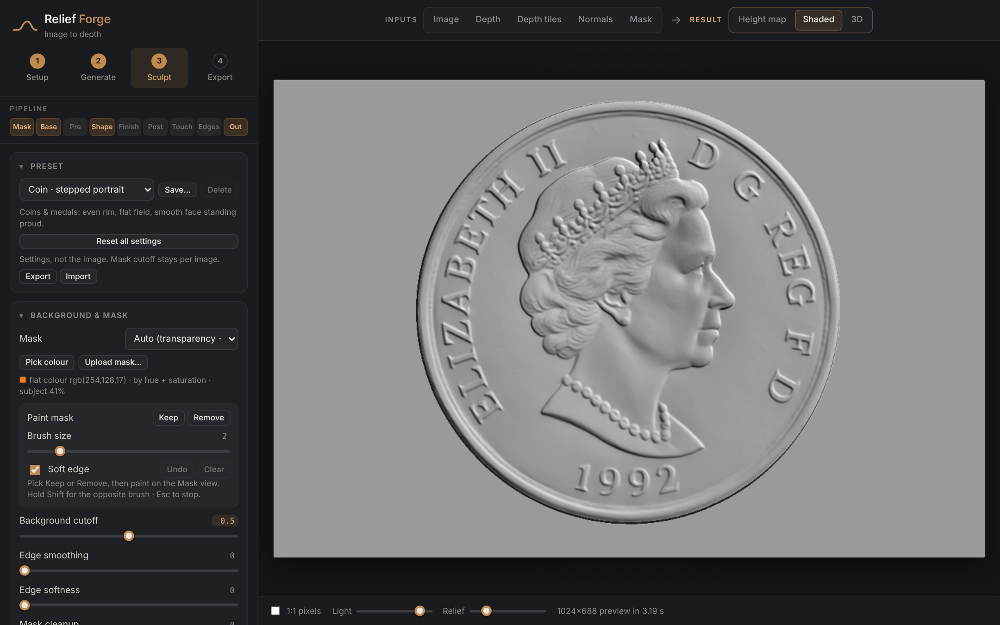
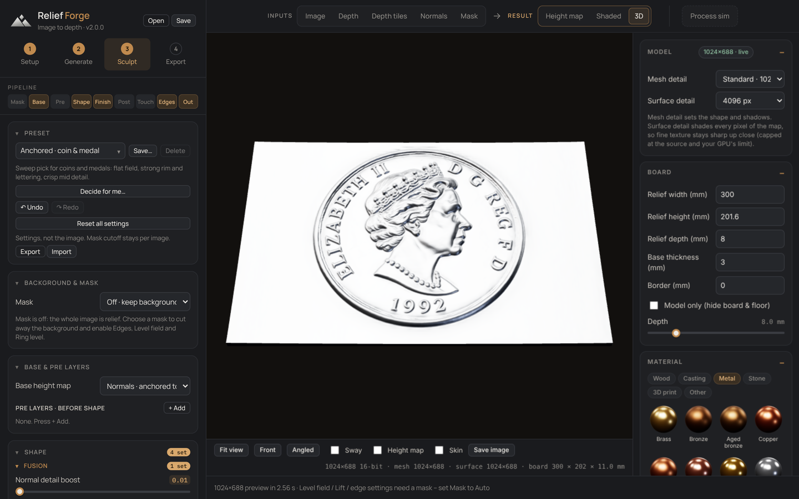
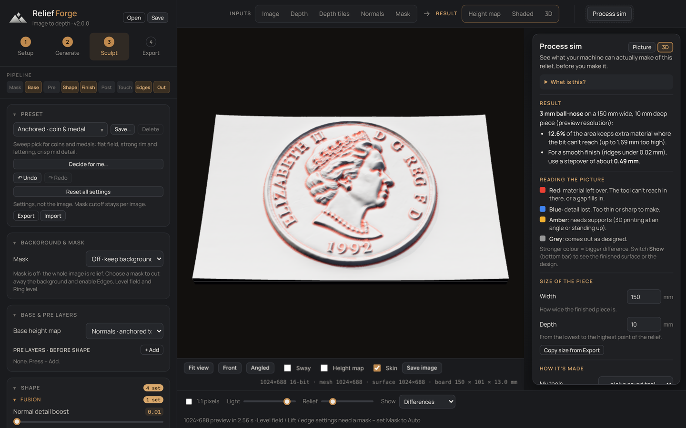

  

<b>Turn a picture into a carvable relief.</b> 
Height maps and STLs for CNC, fibre-laser engraving, 3D printing and moulds, made in your browser.

  <a href="https://snazzygaz.github.io/DepthNormal/"><b>Open it</b></a> ·
  <a href="#get-it">Get it</a> ·
  <a href="#how-it-works">How it works</a> ·
  <a href="docs/Relief-Forge-Basics.pdf">User guide (PDF)</a> ·
  <a href="#licence">Licence</a>

---

## What it does

Relief Forge turns an ordinary picture into a **height map**: a greyscale image where **white = high** and **black = low**. CNC routers, fibre lasers and 3D printers read that grey as depth, so your picture comes out as a raised, carved object: a coin, a medal, a badge, a stone panel or a statue relief.

Two AI models look at your picture. One estimates **distance** (depth), the other estimates **surface direction** (normals). Relief Forge blends the two into a clean relief, then gives you presets and sliders to shape it, a live 3D preview, and export to 16-bit PNG, STL and more.

**Everything runs on your own computer.** Pictures are never uploaded. The AI models download once and are cached by your browser.

## Features

**Making the relief**
- **Image → height map** with Depth Anything 3 (depth) and MoGe-2 (normals), fused into one relief
- **Normals anchored to depth** base: crisp detail from the normals, front-to-back order from the depth, so faces don't tilt or bowl. *Depth anchoring size* sets the crossover
- **Tiled passes** for extra detail on large images (3 or 4 across), and automatic removal of the faint grid the normal model leaves on flat areas
- **Max quality normals**: each tile is run twice, slightly shifted, and averaged for cleaner flat areas. Pair with 4-across tiles for the most detail
- **Fine detail from the picture**: adds hair, fur and engraving texture from the image itself. Works live and can be changed any time; it isn't baked in
- **Background masking**: automatic, flat-colour pick, transparency, or paint it yourself

**Presets**
- **Recommended** group, chosen by testing ~180 setting combinations and checked on 22 projects (coins, statues, animals, machines, photos and stone renders). New images start from *Anchored · all-rounder*
- **Decide for me…** tries the Recommended presets on your image and shows them side by side with a scored pick
- Older presets kept under **Legacy**, plus your own saved presets. Presets leave your edge settings alone

**Shaping**
- **Shape, finish and edge controls**: levelling, detail EQ, crease deepening, soft roll-off to the background
- **Rim lock** for coins: one exact rim profile all the way round, width found automatically (double-click)
- **Mould draft**: slopes steep walls so casts release; only adds material at the foot of walls
- **Layers** to blend in other maps, and a **touch-up brush** to raise, lower and smooth by hand
- **Undo / redo** for settings (Ctrl+Z / Ctrl+Y)

**Checking it**
- **Live 3D showroom** with materials (metals, wood, stone, resin…), lighting, and a "skin" view of your original picture on the model
- **Process sim**, a side check next to the result tabs: shows what a CNC bit (ball, tapered, V, flat, bull-nose, with stepover ridges), a filament or resin printer, or a laser can really make. As a colour-coded picture or in 3D at real size, with a plain-language result and a saved library of your tools

**Saving**
- **Export**: 16-bit PNG, STL (with optional silicone pour box and print-bed splitting), normal map, and `.relief` project files. Save dialogs open in the folder you last used
- **Mould mode**: invert and mirror for casting
- **Autosave** with *Restore last session* on the next start, and **Recover GPU** after a graphics-driver reset without restarting the browser

## Get it

| | |
|---|---|
| **Use in the browser** | [Open Relief Forge](https://snazzygaz.github.io/DepthNormal/) |
| **Desktop app** | Windows (installer .exe, recommended; also .zip and portable) and Linux (AppImage, .deb) from [Releases](../../releases/latest). Updates itself, native save dialogs, works offline after the first run. See [desktop/](desktop/) |
| **Download** | Save [index.html](index.html) and open it in Chrome |

Open it in **Chrome** or **Edge**. No installation and no account are needed.

### What you need

- A recent Chrome or Edge on Windows, macOS or Linux
- A graphics card with WebGPU support for good speed. Without one it still works on the CPU, just slowly.
- About 1 GB of free space for the AI models, and an internet connection for the first run
- **A good picture**: high resolution, sharp, evenly lit, with the subject separated from its background (transparent or a single plain colour). AI image editing can help prepare one.

> **Linux:** WebGPU is on by default in Chrome only for some GPUs (e.g. Intel Gen12+, recent NVIDIA on Wayland). On others it falls back to the CPU unless Chrome is launched with WebGPU enabled.

## How it works

| Step | What you do |
|---|---|
| **1 · Setup** | Load the depth and normal models. Slow only the first time. Or open a saved `.relief` project. |
| **2 · Generate** | Add your picture and press **Run passes**. |
| **3 · Sculpt** | Pick a preset (or press **Decide for me…**), adjust the sliders, and watch the Shaded and 3D views update. Check it in **Process sim** if you like. |
| **4 · Export** | Download the 16-bit height map, an STL, the normal map, or save the project. |

### Which preset?

Start in the **Recommended** group at the top of the list.

| Subject | Preset |
|---|---|
| Not sure / anything | **Anchored · all-rounder**, or press **Decide for me…** |
| Coin, medal, badge, emblem | **Anchored · coin & medal** |
| Statue, figure, creature | **Anchored · keeps volume** (most depth) or **Anchored · crisp contrast** (punchier) |
| Scenes and textures | **Anchored · all-rounder** or **Crisp · classic base** |
| Starting from scratch | **Neutral · base only** |

The full walkthrough, with every panel explained in plain English, is in the **[user guide (PDF)](docs/Relief-Forge-Basics.pdf)**.

## Tips

- **Input quality beats settings.** A sharp, clean, cut-out picture gives a cleaner relief than any slider can. Crop to the subject.
- For things with colour or shine (cars, clocks, animals), have an AI image editor turn the picture into **plain white stone on a plain background** first. Flat art such as signs and lettering works fine as it is.
- Use the **16-bit PNG** for CNC and lasers. 8-bit gives visible steps.
- **Shaded** is the easiest view for judging the result. **3D** shows how it will really look.
- If you get a **"device lost"** or GPU error, press **Recover GPU** and run the passes again. Closing other GPU-heavy programs and lowering *Normal detail* helps.
- Use **Process sim** before cutting or printing: red shows where your bit can't reach, so you know where a finer bit (rest pass) is needed.
- Save a **project** (`.relief`) to come back later without re-running the AI.

## Licence

**Relief Forge** © 2026 Garyck Arntzen. Free to use. All rights reserved: no copying, modification or redistribution of the application without permission. Provided as is, without warranty. The reliefs you make with it are yours.

### Third-party components

| Component | By | Licence |
|---|---|---|
| Depth Anything 3 · Mono Large | ByteDance Seed (Depth Anything team) | Apache 2.0 |
| DA3 Mono Large ONNX conversion | Jens Duttke | Apache 2.0 |
| Depth Anything V2 · Large / Base *(optional)* | Depth Anything team; ONNX by onnx-community | CC BY-NC 4.0, **non-commercial only** |
| MoGe-2 normal models | Microsoft | MIT |
| DINOv2 (inside MoGe-2) | Meta AI | Apache 2.0 |
| ONNX Runtime Web | Microsoft | MIT |
| three.js | three.js authors | MIT |
| Manrope, IBM Plex Mono | Mikhail Sharanda; IBM | SIL Open Font Licence 1.1 |

The AI models are downloaded from Hugging Face on first use and are not part of this repository. Full details in [THIRD_PARTY_NOTICES.md](THIRD_PARTY_NOTICES.md); the app licence is in [LICENSE](LICENSE).

> **Commercial use:** use Depth Anything 3 for depth. Depth Anything V2 Large/Base are for non-commercial use only.
